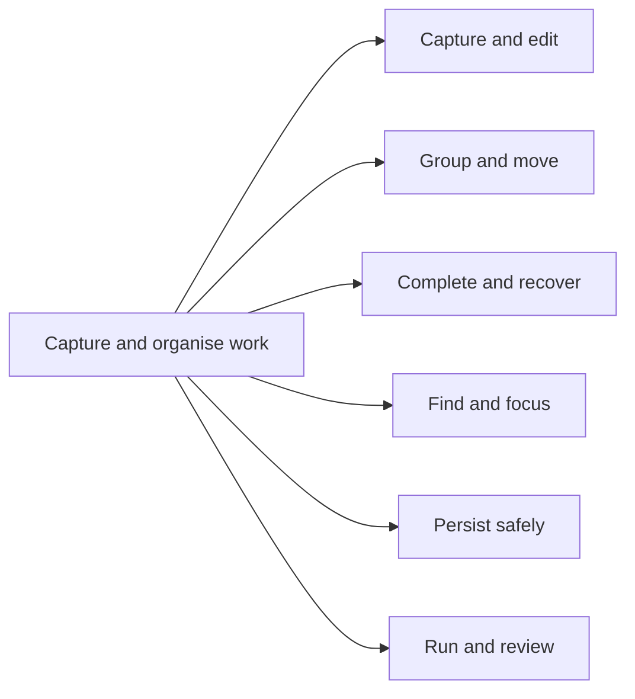
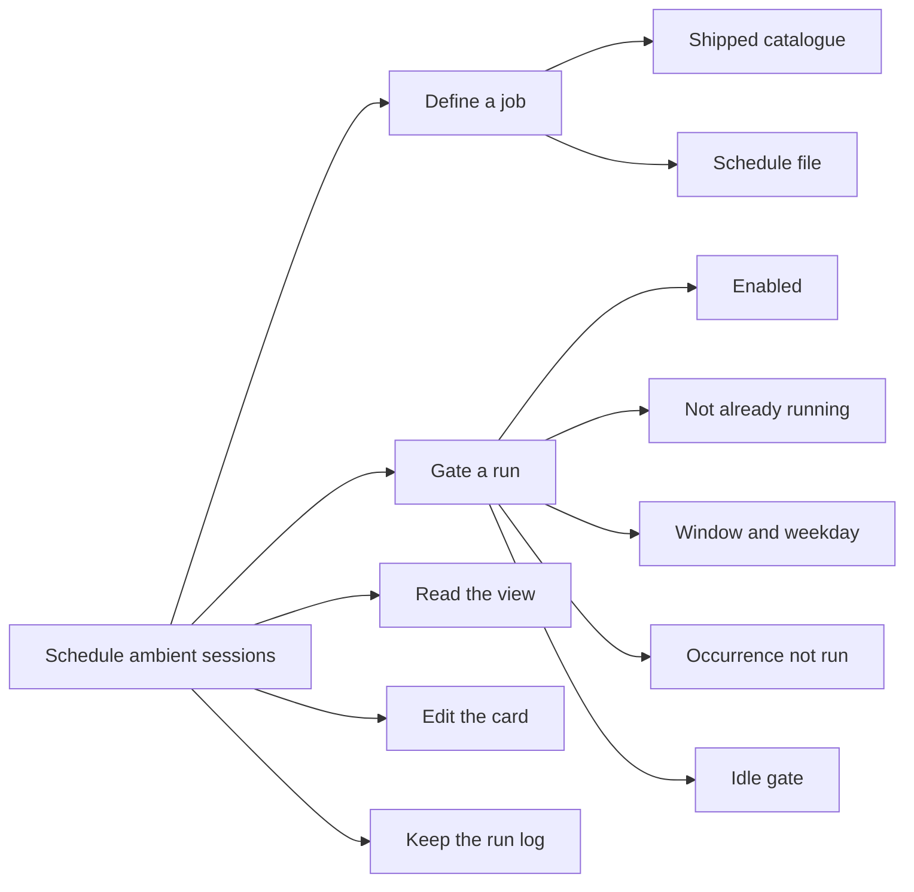
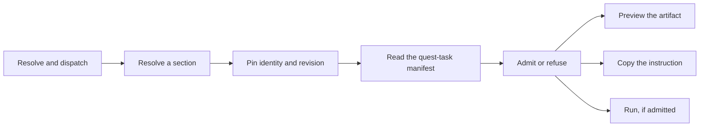
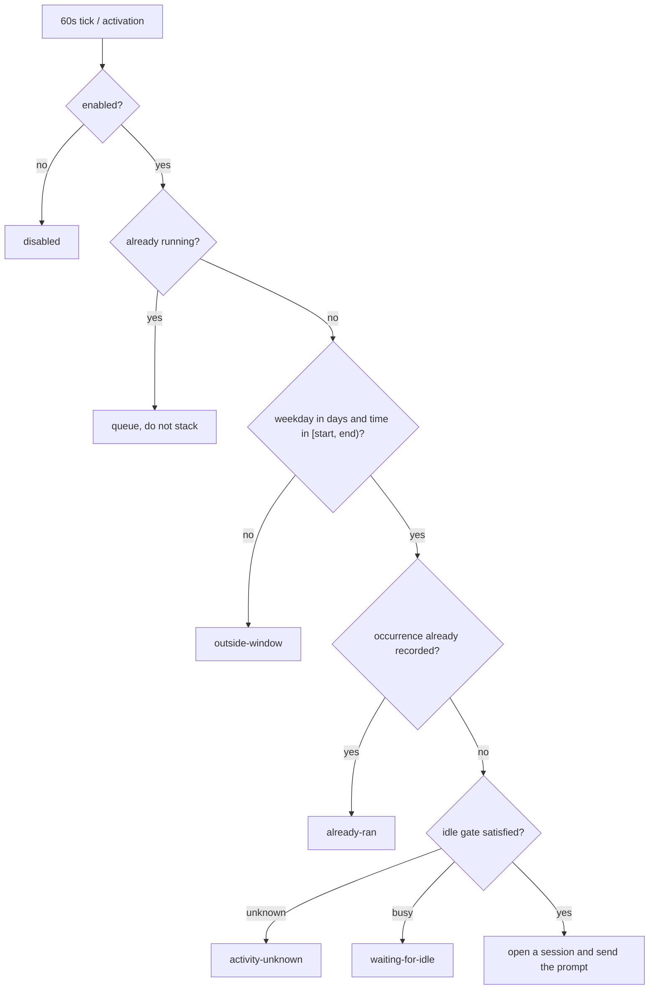

# Quest ADE Features

The behavioural ledger for Quest ADE: what exists and can be observed today, and
what is planned but not built. Purpose and boundaries are in
[VISIONS.md](VISIONS.md); delivery order is in [ROADMAP.md](ROADMAP.md);
vocabulary is in [CONCEPTS.md](CONCEPTS.md).

## Reconstruction Target

Recreate Armory's observable editor workflows, data contracts, state transitions,
failure handling and delivery tooling. The Armory contracts below are
**provisional implementation observations, 2026-10-26**, not newly accepted
requirements or a claim that every installed extension matches this checkout.
This tree is the specification authority, as settled in
[D14](DECISIONS.md#d14--specs-is-the-quest-ade-specification-authority).

Use this document as an agent prompt:

> Reconstruct the implemented Armory capabilities in the Feature Tree and
> Journey Contracts. Preserve the named command IDs, storage identities, input
> validation, ordering, side effects, refusal paths and recovery semantics.
> Implement and verify one outcome at a time using the Verification Map. Do not
> implement the planned ledger, documentation-only experiments or Known Gaps as
> though they ship. Do not infer permission to run, retry, merge or publish from
> an identifier. Report any material detail this contract leaves unspecified;
> do not silently invent it. Preserve native VS Code surfaces and keep external
> credentials and private specifications outside the reconstructed package.

Behavioural equivalence is the target, not byte-identical source or pixel-identical
screenshots. Source and tests remain evidence for unresolved details, not an
excuse to omit observable rules from this document. A clean-room reconstruction
has not been performed; the Known Gaps bound that claim.

## Entry Points

Every Armory capability is reached through a VS Code contribution, a repository
recipe, or a registry file. The command IDs below are the exact strings the
manifests declare; a reconstruction must keep them, because keybindings, menus
and the `agentEnvoy.getState`-style references match on the string.

| Entry | Owner | Intended user |
| --- | --- | --- |
| `agentInbox.showPanel` … 18 `agentInbox.*` commands; view `agentInbox` | `agent-inbox` | Workspace operator capturing and organising work |
| `agentTodo.open`, `agentTodo.capture`; view `agentTodo.tasks` | `agent-todo` | Operator keeping a local task list |
| `agentSchedule.*` (9 commands); view `agentSchedule` | `agent-schedule` | Operator scheduling recurring agent sessions |
| `agentGuide.refresh`; view `agentGuide` | `agent-guide` | Operator browsing local `.agents` guidance |
| `agentQuest.resolveSelection`, `copyIdentity`, `openEntity`, `previewCommission` | `agent-quest` | Operator turning a roadmap heading into a commission |
| `agentSpecs.previewCommission`, `copyCommission`, `runCommission` | `agent-specs` | Operator previewing and running a commission |
| `agentArea.openLocus`; view `agentArea.seats` (Explorer) | `agent-area` | Operator navigating seats from the component registry |
| `agentResume.inspectFailure`, `prepareHandoff`, `resumeIfSupported`, `cancelRetry` | `agent-resume` | Operator diagnosing a stopped agent session |
| `agentAwake.*`, `agentBrowser.*`, `agentCommit.syncWorkspace`, `agentEnvoy.*`, `agentEta.show`, `agentRam.*`, `agentWidth.*`, `agentRouter.configure`, `agentLatency.*`, `auroraModelProvider.*`, `opencodeGoProfiles.*`, `auroraCopilotPlus.openSettings` (27 commands) | `aurora-copilot-plus` | Operator running and steering the agent host |
| `auroraVscode.refresh`, `selectFilters`, `selectScmRepositories`, `porterConfig`, `markdownPreview`, `markdownSource`, `markdownToggle`, `markdownAddToChat` | `aurora-vscode` | Operator filtering the workspace tree and reading notes |
| `just refresh-extension <extension>`, `just dev-host <extension> [port]` | `extensions/justfile` | Maintainer delivering an extension |
| `just package`, `just install`, `just generate`, `just check`, `just explorer-report`, `just icons`, `just preview` | `themes/justfile` | Maintainer building the theme VSIX |
| `.agents/.schedule/<id>.md` | `agent-schedule` | Operator adding a schedule as a file |
| `.INBOX.md` | `agent-inbox` | The durable backlog the operator and extension share |
| `auroraVscode.folders.registry` → `.vscode/settings/folders.yaml` | `aurora-vscode` | The folder-class registry the picker and settings generator share |

## Feature Tree

Capabilities are grouped by the operator outcome they serve, not by source
folder. A group whose behaviour branches points to the decision tree that
governs it.

### Capture and organise work — `agent-inbox`, `agent-todo`

Advances [V4](VISIONS.md#v4--small-composable-surfaces-not-a-second-ide): small
discoverable contributions in the existing sidebar. The operator captures work
without leaving the editor, and the Markdown file, not the view, owns content and
order.

| Capability | Trigger | Non-goal | Acceptance |
| --- | --- | --- | --- |
| Quick capture | Submit a non-empty title in place | Not a dialog per field | A non-empty title creates one bullet; empty title creates none; Escape writes nothing |
| Inline edit | Feature title, body or scope description | Not a separate editor surface | A rejected save preserves the draft and reports the error |
| Scope organisation | Two-level scopes; deeper headings stay content | No third navigation level | Scopes contain features; deeper headings are content |
| Pointer reorder | Drag a feature to a header's upper/lower half | Not a separate drag handle | Insertion line marks the boundary; editors and controls never start a drag |
| Cross-scope move | Drag over a scope background or empty scope | Not archived or search-hidden rows | Hidden scopes become available mid-drag; release appends |
| Keyboard move | Alt+Up/Down, Alt+Left/Right, Alt+M | No wraparound at a boundary | Visible, non-archived siblings only; boundary is a no-op |
| Completion toggle | Checkbox click or Space on the feature body | Does not open the parent editor | Writes one marker; leaves heading and neighbouring bullets intact |
| Archive and restore | Archive control; restore by editing the file | No archive-browser UI | Archive strikes text without deleting; removing the strike restores |
| Search and folding | Search field; explicit folds | Query and folds are view state | Matches title, scope path, description and body; state survives reload |
| Safe persistence | Every write | Not last-writer-wins | Writes re-read and compare revision; a stale gesture is refused |
| Manual execution | Play, Run all, session link | Not a scheduler | Play opens a new Copilot session with scope context; the link is recorded |

`agent-todo` shares the outcome but not the store: its scope/priority/board
model, rich-text notes, nested subtasks, bounded list rendering with **Show more
tasks**, and 30-edit in-memory undo history are workspace-state only, with no
Markdown file and no network service.

### Schedule ambient agent sessions — `agent-schedule`

Advances [V2](VISIONS.md#v2--the-human-stays-in-the-loop-at-the-seams-that-matter):
a recurring job opens a session and sends its prompt; the extension records how
the run ended, never whether the work was good. See
[Journey Contracts § Schedule Gate And Run](#schedule-gate-and-run).

| Capability | Trigger | Non-goal | Acceptance |
| --- | --- | --- | --- |
| Shipped catalogue | Activation | Not a code path per job | Six jobs: learn, review, diary, cleanup, resources, pull requests; cleanup, resources and pull requests ship disabled |
| Schedule file | `.agents/.schedule/<stem>.md` written | Not a second schedule directory | The stem is the id; the file overrides the catalogue; a bad file is logged and skipped, others still load |
| New schedule | Title-bar plus button | Not a form of many fields | Asks name and window; writes `.agents/.schedule/<id>.md` disabled and opens it; an in-use stem gains `-2` |
| Gate | 60-second tick, once at activation | No catch-up for a missed window | Enabled, not running, window, occurrence, idle, in that order |
| Idle gate | `require` / `prefer` / `off` | Not workspace-scoped | Read from `~/.agent-frame` snapshots; a snapshot whose process is gone or older than 12 hours is ignored; a missing directory is `unknown`, not `idle` |
| View | Secondary Side Bar webview | Not a tree; not a status strip | One line per job; hover actions replace the schedule; refresh swaps rows in place, preserving scroll and fold |
| Job card | Click a job row | One reused panel, not a tab per job | Read-only except the prompt; a draft holds refreshes back |
| Run log | `agentSchedule.showLog` | Logs a prompt by length, not by content | Last 40 lines per job in workspace storage, mirrored to the Output channel |
| Manual run | Hover play button | Bypasses gates by design | Still records the occurrence, so an automatic run in the same window is skipped |

### Resolve, preview and dispatch a commission — `agent-specs`, `agent-quest`

Advances [V2](VISIONS.md#v2--the-human-stays-in-the-loop-at-the-seams-that-matter)
and [D8](DECISIONS.md#d8--an-identifier-is-not-an-authorisation): an identifier
is not an authorisation, so resolution and admission are separate events and
merge is never authorised. See [Journey Contracts § Commission Resolution And
Admission](#commission-resolution-and-admission).

| Capability | Trigger | Non-goal | Acceptance |
| --- | --- | --- | --- |
| Section resolution | Selection over a `## <ID> — <Title>` heading | Not a Board service dependency | The ID lives in the heading, so a title rename never changes identity; ID shape is `^[A-Z]{2,10}-\d{3}$` |
| Revision pin | Every resolution | Not a floating source | Revision is `sha256:<hex>` over the section text; a stale selection is refused |
| Manifest read | A fenced quest-task block adjacent to the heading | Not a guess at missing fields | `scope` must be a mapping and `scope.include`/`exclude`/`depends_on` lists; a wrong shape is a diagnostic, never an empty declaration |
| Admission | Run on an admitted commission | Not a merge authorisation | Refuses with `not_admitted`, `no_adapter`, `missing_oracle`, `stale_source`, `code_unavailable` or `malformed_declaration`; a prose heading offers **Create Draft**, never **Run** |
| Artifact | Preview or copy | Not a second task ledger | Carries contract id `quest-commission/0-proposed`, forbidden effects (`merge`, `deploy`, `publish`, `force-push`, `unapproved-external-effect`) and the stop rules; secrets are redacted |

### Navigate the seat registry — `agent-area`

Advances [V5](VISIONS.md#v5--areas-projects-specs-and-resources). The navigator
is a compact view inside the existing Explorer, not a new destination.

| Capability | Trigger | Non-goal | Acceptance |
| --- | --- | --- | --- |
| Seat read | Activation; refresh | Not a silent drop on an unreadable line | `amber/components.yaml` is read totally: a line it cannot read becomes a recorded problem, not a missing seat |
| Seat identity | Each entry | Not a lie about registration | `name`, `path`, `type`, `private` and `description` are read; a multi-line `description` is folded |
| Navigator | `agentArea.seats` in the Explorer | Not an Activity Bar container | Renders seats; `agentArea.openLocus` opens the seat's locus |

### Diagnose and resume a failed session — `agent-resume`

Advances [V2](VISIONS.md#v2--the-human-stays-in-the-loop-at-the-seams-that-matter).
The classification is the input to the decision, not a label applied after it.
See [Journey Contracts § Failure Classification And Resume
Decision](#failure-classification-and-resume-decision).

| Capability | Trigger | Non-goal | Acceptance |
| --- | --- | --- | --- |
| Classify | `agentResume.inspectFailure` | Not a guess at a transient cause | One of `cancelled`, `blocked_effect`, `quota`, `auth`, `transport`, `tool`, `non_resumable`, `unknown`; unsupported evidence is `unknown` |
| Decide | `decide(input)` | Not a second failure | Only `transport` maps to `retry`; every other class maps to `handoff`, `report_limit`, `terminal`, `honour_cancellation` or `block` |
| Retry gate | A retry decision | Not unbounded | `retry_budget_remaining > 0` and the operation is not explicitly non-idempotent; a failed gate becomes `handoff` with `needs_user_action` |
| Coverage check | Module load | Not a silent fallback | A class with no policy entry throws, so the gate never depends on a default |
| Handoff and cancel | `prepareHandoff`, `cancelRetry` | Not an automatic restart | Handoff reports the tool and cause; cancellation is honoured, never retried |

### Operate the editor and workspace — `aurora-vscode`

Advances [V4](VISIONS.md#v4--small-composable-surfaces-not-a-second-ide). Each
capability is a small contribution over a native surface. See
[Journey Contracts § Folder Filter](#folder-filter) and [§ Markdown Preview
Edit And Toggle](#markdown-preview-edit-and-toggle).

| Capability | Trigger | Non-goal | Acceptance |
| --- | --- | --- | --- |
| Folders filter | Title-bar filter button | Not a second reveal button | Porter-type, folder-class, symlinked and no-remote rows; each tick applies immediately, so dismissing is not a cancel |
| Exclusion delta | A filter change | Not a clobber of user exclusions | Records the keys it wrote, removes exactly those, and forces class-controlled directories back to their ticked state; unrelated exclusions untouched |
| Scan triggers | Activation, `porter.yaml` change, folder change, refresh, filter switch, git state | Not a hand-maintained list | Scans queue behind one another and re-derive from git |
| Sectional comments | Editor visible / text changed | Not a guessed language | Divider and heading classified from shape; JSON takes a theme-resolved orange, others borrow `editorInfo.foreground` |
| Inline comment continuation | Enter after an inline comment | Not a replacement of language configuration | Re-registers a language with the rule appended to `onEnterRules`, carrying every other key and converting `autoClosingPairs`; a language registers when first opened |
| Markdown preview | Open `*.md`/`*.markdown` | Not the default editor | Registered at `priority: option`; edits reach the in-memory document with no save; theme colour resolves live |
| Add to chat | `markdownAddToChat` | Not a selection or an image | Waits for pending edits, attaches the whole document URI through `workbench.action.chat.addToChatAction`; a missing host action is reported |
| Porter action | `porterConfig`, `porter.compileOutputs` | Not a hand-edited generated file | Delegates to the configured `auroraVscode.porter.command` |

### Operate the agent host and providers — `aurora-copilot-plus`

Advances [V1](VISIONS.md#v1--a-portable-agentic-development-environment) and
[D9](DECISIONS.md#d9--aurora-copilot-plus-is-the-merged-status-bar-package): the
merged successor of four status-bar extensions, plus provider routing. See
[Journey Contracts § Provider Routing And Quota Fallback](#provider-routing-and-quota-fallback)
and [§ Sidebar Width Resize](#sidebar-width-resize).

| Capability | Trigger | Non-goal | Acceptance |
| --- | --- | --- | --- |
| Feature switches | `auroraCopilotPlus.*.enabled` | Not a reload | A change stops and restarts the feature immediately, removing its status-bar item and commands |
| Feature isolation | Feature start-up or teardown throwing | Not a whole-extension failure | The fault is reported against its own name in the output channel; the rest keep running |
| Keep-awake | `agentAwake.*` hooks | Not a simulated idle | Installs and removes Claude Code and Copilot Chat hooks |
| ETA | Awake click, `agentEta.show` | Not invented precision | A percentage appears only from the session's own todo list; `ETA uncertain` otherwise; pacing is learned from observed completions |
| Commit and sync | `agentCommit.syncWorkspace` | Not a forced push or a bypassed hook | Stages, generates a message, commits with hooks, then fetches, rebases and pushes to existing upstreams; a failure requests its own recovery chat |
| RAM and cleanup | `agentRam.show`, `cleanDangling` | Not a hidden kill | Reports agent-tree and whole-tree memory; sweeps known dangling processes only when enabled |
| Width | `agentWidth.*` | Not an arbitrary-size promise | Target is the reachable lattice `170 + n × 60`; a row off the lattice carries a warning glyph |
| Router | `agentRouter.configure` | Not a Copilot-billed fallback | Delegates to already-registered models; refuses to route to itself or to Copilot |
| Providers | `auroraModelProvider.*`, `opencodeGoProfiles.*` | Not a credential export | Registers five AMP vendors plus the router; credentials live in SecretStorage; model ids are opaque and profile-qualified |

### Browse local agent guidance — `agent-guide`

Advances [V4](VISIONS.md#v4--small-composable-surfaces-not-a-second-ide): a
tree over the shared `.agents` tree with no remote catalogue.

| Capability | Trigger | Non-goal | Acceptance |
| --- | --- | --- | --- |
| Resource scan | Activation; `agentGuide.refresh` | Not a remote catalogue | Reads `hooks` (files), `mindset` (`.md`), `skills` (directories with `SKILL.md`), `personas` and `workflows` (`.md`, excluding `README.md`); a missing directory is empty, not an error |
| Ordering | Every scan | Not file-system order | Results are sorted by name |
| Activation | Container opening | Not a start-up cost | Declares no `activationEvents`; the container activates it |

### Deliver the shared baseline — themes, recipes, Porter configuration

Advances [V4](VISIONS.md#v4--small-composable-surfaces-not-a-second-ide) and
[D10](DECISIONS.md#d10--one-vsix-per-theme-family-pair-one-repository-recipe).

| Capability | Trigger | Non-goal | Acceptance |
| --- | --- | --- | --- |
| Theme generation | `just generate` | Not hand-edited JSON | Each `theme.jsonnet` is rendered to `theme.json` and validated with `jq -e .` |
| Drift check | `just check` | Not a write | Renders every `theme.jsonnet` and validates, writing nothing |
| Theme package | `just package`, `just install` | Not six VSIXes | One `aurora-themes.vsix` for all six themes; `install` forces the installed copy |
| Extension delivery | `just refresh-extension <extension>` | Not a source-only test run | Bumps the patch version, packages, installs and diff-verifies; the bump is load-bearing for the Activity Bar icon mask |
| Configuration composition | Porter `config` role | Not a hand-maintained root | Root hygiene and editor configuration are materialised from the TabJS base |

## Decision Trees

Each table names the input that causes the branch and the outcome it selects.
Product, workflow and security decisions are kept apart from implementation
choices; the schedule gate is the one stage flow, because its exits are what
prose cannot carry.

### Inbox move gesture

| Input or condition | Result |
| --- | --- |
| Pointer travels less than 6 CSS pixels | Remains a click; no move request |
| A save or editor/composer is open | No gesture starts; draft and pending write undisturbed |
| Pointer enters another scope outside a feature | Highlight the scope; release appends there |
| Pointer enters another visible feature | Before/after feedback from the header midpoint |
| Pointer returns to its own feature, its own scope background, or outside a scope | No destination and no write |
| Escape, pointer cancellation, lost capture or window blur | Clear feedback, restore the filtered view, cancel without writing |
| No visible keyboard neighbour, or a scope boundary reached | No write; no wraparound |
| Destination holds another feature with the same title | Host refuses the move and reports the conflict |
| File revision changed during the gesture | Host refuses the starting revision and refreshes |

### Schedule gate

### Commission admission

| Input or condition | Result |
| --- | --- |
| Selection is prose, not a `## <ID> — <Title>` heading | No commission metadata; offer **Create Draft**, never **Run** |
| Heading resolves, but its revision is not the pinned source revision | Refuse with `stale_source` |
| Target checkout revision is not pinned | Refuse with `code_unavailable` |
| `scope` or `depends_on` has the wrong shape | Refuse with `malformed_declaration`; the declaration is projected, not collapsed |
| No admitted runner adapter exists | Refuse with `no_adapter`; **Run** stays disabled, the instruction is copied for manual execution |
| No reviewer-pinned acceptance oracle | Refuse with `missing_oracle` |
| Heading carries no admitted quest-task commission | Refuse with `not_admitted` |
| Every gate passes | Admit; preview and copy the artifact; **Run** dispatches one commission |

### Resume decision

| Class | Action | Retry? |
| --- | --- | --- |
| `transport` | `retry` | Only with budget remaining and an operation not explicitly non-idempotent |
| `cancelled` | `honour_cancellation` | No |
| `blocked_effect` | `block` | No |
| `quota` | `report_limit` | No |
| `auth` | `handoff` | No |
| `tool` | `handoff` | No |
| `non_resumable` | `terminal` | No |
| `unknown` | `handoff` | No |

### Folder filter

| Input or condition | Result |
| --- | --- |
| A repository's manifest declares a Porter type | Listed under that `[type]` heading |
| A repository declares no type, or a top-level directory carries no manifest | Listed under `[N/A]` |
| A top-level directory is a symlink | Listed under **Symlinked**; a mount is claimed before every class |
| A dot-named or git-ignored directory matches a registry class | Listed under that class's group; a class claims it only if it declares `repositories: true` |
| A repository has no remote | Listed under **No remote** |
| A class row is unticked | Its directories are excluded; a symlink is hidden if either its class or **Symlinked** is unticked |
| The workspace root | Never a row; `files.exclude` cannot hide the tree root |

### Provider routing

| Input or condition | Result |
| --- | --- |
| Selector vendor is the router or `copilot` | Refuse: the router cannot route to itself or to Copilot |
| No exact `{vendor, id}` pair configured | Error; no default id is shipped, because ids are opaque and profile-qualified |
| The chain for the current period is empty | The period is reported missing; other periods are unaffected |
| The backend rejects with `LanguageModelError.Blocked` or a rate-limit/`429` message | Treat the entry as spent for now and move to the next entry |
| The socket dies (undici `terminated` / `fetch failed`) | Do **not** cool the entry; the same backend serves the next request |
| The request was cancelled | Never retried |
| Output already published before the failure | Fail rather than replay a partial response |

### Markdown toggle

| Input or condition | Result |
| --- | --- |
| The note in front is the one being previewed | Toggle to the side it is not on |
| A menu names a note other than the one in front | Open whichever side *that* note is not on |
| The active tab holds anything that is not Markdown | Declined, not guessed at |

## Journey Contracts

### Capture And Edit An Inbox Item

`title + body + destination + revision -> validated write -> updated Markdown`

The operator captures work in one form, not one dialog per field. Durable state is
`.INBOX.md`; the view holds only search, folding and the Done filter. The write is
line-targeted: the extension replaces the lines it owns and leaves every other byte
alone, so a hand-written backlog survives.

- **Invariant** — only bullets are todos; prose is a section's description and is never rewritten. A heading nests by indentation first and `#` count second, so an indented `##` stays under the heading above it.
- **Failure** — an empty title creates no task; a write re-reads and compares the revision, so a stale gesture is refused and the list refreshes; a rejected save preserves the draft.
- **Example** — entering `Review cache keys` under `Porter` creates a bullet there; Escape before submission leaves the file unchanged.

### Move An Inbox Feature

`feature id + scope id + optional position + starting revision -> moveFeature -> reordered subtree`

Movement carries the heading, body, nested headings, completion and session
metadata together. Destination status is announced without adding a layout row,
and archived or search-hidden features are not insertion targets.

- **Invariant** — the host validates identity, destination, duplicate titles and heading levels before writing; a drag below the 6px threshold is a click.
- **Failure** — a duplicate title in the destination is refused; a changed file revision is refused; Escape restores the pre-drag filtered view without writing.
- **Example** — moving `Alpha feature` from `Orchard` to `Empty scope` sends its original id, the destination id and the starting revision; Alt+Right makes the same move when the scopes are adjacent.

### Complete, Archive And Recover

`checkbox state or archive request -> targeted marker write -> refreshed list`

Completion and archive are separate durable states. A plain bullet has no
checkbox; a checkbox bullet supports pointer or Space without opening the body
editor.

- **Invariant** — explicit feature completion does not rewrite its bullets; Done reveals completed features while archive stays hidden.
- **Failure** — one-click Undo is a target, not a current guarantee; a rejected marker write preserves the previous state.
- **Example** — toggling `- [ ] Primary task` writes `- [x] Primary task`, leaving the feature heading and neighbouring bullets intact.

### Schedule Gate And Run

`job + local time + run record + agent activity -> gate verdict -> session start or a stated skip`

The gate is evaluated in one order and records the occurrence it allowed. Run
records, per-job logs and overrides are durable in workspace storage
(`agentSchedule.runs`, `agentSchedule.logs`, `agentSchedule.overrides`); a run
recorded as `running` when the window closed becomes `interrupted` on the next
activation.

- **Invariant** — one run at a time; a window cannot wrap past midnight; an occurrence is the local date of its window, or the local hour for `every: hour`; the record is machine-scoped, so two windows cannot both run a job.
- **Failure** — there is no catch-up for a window that passed while VS Code was closed; a snapshot whose process is gone or older than 12 hours is ignored; a missing `~/.agent-frame` directory yields `unknown`, not `idle`.
- **Example** — Resources (`every: hour`, `idle: off`) starts once in each hour its window covers; a job that stays gated through a whole hour waits for the next.

### Schedule File As Source Of Truth

`markdown file text -> frontmatter + prompt body -> job definition or a reported problem`

One Markdown file per job under `.agents/.schedule/`; the file's stem is the job
id, so a new schedule is a new file rather than a new code path, and it is picked
up without a reload.

- **Invariant** — the frontmatter is a small subset of YAML: `key: value` lines, `[0, 1]` lists, `HH:MM-HH:MM` windows, whole-line `#` comments and optional quotes; a `#` inside a value is part of the value.
- **Failure** — a file that cannot be read is reported in the log and skipped, so one bad file cannot stop the others; an unknown key or a malformed `window` is reported rather than half-applied; only `window` is required.
- **Example** — `cleanup.md` replaces the shipped `cleanup` job; a stem the catalogue does not have is a new job; **Export Schedules to Files** writes the effective catalogue and a written file drops that job's overrides.

### Commission Resolution And Admission

`selected heading text -> pinned identity + revision + manifest -> admission verdict -> artifact`

Resolution and admission are separate events. A passing check is evidence, not
authority: no command, digest or green check implies a merge gate.

- **Invariant** — the ID lives in the heading, so renaming the title or moving the section never changes identity; the revision is `sha256:<hex>` over the section text; `scope` must be a mapping and `scope.include`/`exclude`/`depends_on` lists.
- **Failure** — a prose selection offers **Create Draft**, never **Run**; a wrong-shaped declaration is a diagnostic, never an empty declaration; each refusal names one reason from the admission vocabulary.
- **Example** — the artifact header carries the contract id and the forbidden effects, so a consumer can reject a contract it does not understand instead of guessing at fields.

### Failure Classification And Resume Decision

`stopped session evidence -> class -> decision -> retry, handoff, report or terminal`

The class is the input to the decision; `decide` reads only `class` and `resume`
reads only the decision, so a class that cannot be justified from evidence cannot
reach a retry.

- **Invariant** — the taxonomy is closed; `unknown` never retries; a retry additionally requires budget and an operation that is not explicitly non-idempotent; the module refuses to load if a class has no policy entry.
- **Failure** — a class the evidence does not support is `unknown`, which hands off rather than guessing a transient cause; an exhausted budget turns a retryable class into a handoff.
- **Example** — a quota failure reports the limit instead of retrying; an expired credential hands off; a transport interruption retries only when the operation is idempotent and budget remains.

### Folder Filter

`registry + git answer -> filter rows -> files.exclude delta -> tree and search`

The picker and the settings generator both read
`auroraVscode.folders.registry`, so the classes a person ticks and the
directories the settings exclude cannot drift apart. Every tick applies as it
happens, so dismissing the picker is not a cancel.

- **Invariant** — a type row supersedes its repositories; a class row is a default for the directories it lists; the exclusion delta removes exactly the keys it recorded and forces class-controlled directories back to their ticked state, leaving unrelated exclusions untouched.
- **Failure** — a scan that would only rewrite equal entries is skipped; the generated `.vscode/settings.json` may be regenerated from Jsonnet and drop the entries, and the next scan re-derives them, so a regeneration costs one write and not the filters.
- **Example** — a repository that gains an origin stops being hidden on its own, because a git state change triggers a rescan; `files.exclude` is also what search uses, so a hidden repository is hidden from search while a filter is on.

### Markdown Preview Edit And Toggle

`document text + theme -> rendered editable note -> in-memory document update`

The preview renders a note in place, in the colour theme already selected, and
edits reach VS Code's in-memory document immediately through a native workspace
edit. No save is required to see an edit in the preview or the source editor;
saving remains a separate action.

- **Invariant** — page tokens are declared as `--note-*` without the `--vscode-` prefix, because the workbench strips and re-adds every `--vscode-*` property on a theme change; every token carries a fallback, because a theme may declare no `textBlockQuote.*` or `textPreformat.*`.
- **Failure** — a stale or refused edit refreshes from the authoritative document instead of overwriting another writer; a missing `workbench.action.chat.addToChatAction` is reported rather than silently ignored.
- **Example** — switching from Aurora Light to Neon Dark restyles the page without a reload and preserves cursor and scroll, because the theme change restamps the root element rather than rebuilding the page.

### Provider Routing And Quota Fallback

`chat request + configured chain -> resolved backend -> streamed response or a reported failure`

A period owns an ordered chain, so a quota-exhausted profile falls through to the
next entry: the other Go profile, then the other provider, then a free last
resort. Authentication stays in each provider's own store.

- **Invariant** — the router refuses to route to itself or to Copilot; the backend is resolved by exact `{vendor, id}`; a turn is pinned by a hash of the messages up to the last non-tool-result user turn.
- **Failure** — a broken entry is reported while the rest of the chain still resolves; an absent chain disables only its own period; a quota failure cools the entry, a transport failure does not, and a cancelled request is never retried.
- **Example** — a spent Codex plan window arrives as HTTP 429 with a `usage_limit_reached` body; the provider replaces it with one sentence naming the plan, the window length and when it reopens, and the router moves to the next entry.

### Sidebar Width Resize

`target width -> focus the side -> repeat the 60px step -> reached width`

VS Code exposes no API to read or set a sidebar's width, so the target is a
target, not a promise: the reachable set is `170 + n × 60`, and the last 30px
cannot be reached.

- **Invariant** — the step is upstream's `RESIZE_INCREMENT = 60` CSS pixels, exact on integer-ratio displays; the floor is a hard clamp at 170px, so over-decreasing is free; a side must be focused for its steps to land on it, and the editor that was active is restored afterwards.
- **Failure** — the commands are gated twice, so in an auxiliary window every step is a no-op; a target off the lattice lands on the nearest reachable width and the menu marks the row with a warning glyph.
- **Example** — a 200px request lands on 230px; the pair action lands on 350px and 470px, the primary alone on 410px, the secondary alone on 530px, because each is a whole number of 60px steps above 170.

### Extension Delivery

`source change -> version bump + package + install -> verified installed artifact`

A source change is not complete until the running copy matches the source. The
recipe runs once at the end, after the package's own tests.

- **Invariant** — the patch version is bumped on every run, because VS Code keys the installed extension directory and the Activity Bar icon mask by publisher, name, version and path.
- **Failure** — the recipe fails on a missing extension directory; an existing VSIX is stale after any source, manifest or icon change and is overwritten.
- **Example** — `just refresh-extension agent-inbox` from the extensions directory bumps, packages, installs and diff-verifies; a reload is required for runtime activation. A manifest identity that differs from the installed one installs a second extension and is recorded as a duplicate rather than a replacement.

## Implementation Map

| Contract | Owning source | Identity that must not drift |
| --- | --- | --- |
| Inbox grammar and line-targeted writes | `extensions/agent-inbox/src` (document/parse layer) | `.INBOX.md` dialect; `TAB_WIDTH = 2`; `NEW_MARKER = '*'`; `# Inbox`; `## Scope` |
| Inbox view and gesture policy | `extensions/agent-inbox/src` (webview + host) | The 18 `agentInbox.*` command ids; view id `agentInbox` |
| Todo store and board | `extensions/agent-todo/src` | `agentTodo.open`, `agentTodo.capture`; view `agentTodo.tasks`; workspace-state keys |
| Schedule gate and run records | `extensions/agent-schedule/src` | Verdict vocabulary; storage keys `agentSchedule.overrides` / `runs` / `logs`; 40-line log |
| Schedule file dialect | `extensions/agent-schedule/src` (file layer) | `.agents/.schedule/<id>.md`; the `[days, detail, enabled, every, idle, label, window]` key set |
| Activity snapshots | `extensions/agent-schedule/src` (activity layer) | `~/.agent-frame`; the 12-hour staleness bound; `require` / `prefer` / `off` |
| Commission resolution and identity | `extensions/agent-quest/src` | `## <ID> — <Title>`; `^[A-Z]{2,10}-\d{3}$`; `sha256:` revision; the four `agentQuest.*` command ids |
| Commission admission and artifact | `extensions/agent-specs/src` | `quest-commission/0-proposed`; the forbidden-effect list; the six `RUN_REASONS` |
| Seat registry read | `extensions/agent-area/src` | `amber/components.yaml`; `agentArea.openLocus`; view `agentArea.seats` |
| Failure taxonomy and decision | `extensions/agent-resume/src` | The eight class names; one action per class; the two retry conditions; the four `agentResume.*` command ids |
| Folder classes and exclusion delta | `extensions/aurora-vscode/src` (folders/exclude layer) | `auroraVscode.folders.registry`; `applyExclusions` semantics; the eight `auroraVscode.*` command ids |
| Markdown preview and comment decoration | `extensions/aurora-vscode/src` (markdown/comment layer) | `--note-*` token prefix; `priority: option`; the appended `onEnterRules` rule |
| Router and provider delegation | `extensions/aurora-copilot-plus/src` (router/provider layer) | Vendor `aurora-byok-router`; model id `auto-byok`; the five `aurora-model-provider-*` vendors |
| Host feature switches | `extensions/aurora-copilot-plus/src` (features) | `auroraCopilotPlus.*.enabled`; per-feature isolation on failure |
| Width lattice | `extensions/aurora-copilot-plus/src` (width feature) | 60px step; the 170px floor; the two focus gates |
| Theme rendering and packaging | `themes/theme.jsonnet`, `themes/theme-helpers.libsonnet`, `themes/justfile` | One `aurora-themes.vsix`; six theme directories |
| Extension delivery | `extensions/justfile` | The `refresh-extension` patch bump and the `diff -r` exclusion set |

## Verification Map

`node --test` in each extension directory runs the listed files; the script names
are the ones the manifests declare.

| Contract | Verification | Covers |
| --- | --- | --- |
| Inbox grammar, round-trip and line writes | `agent-inbox`: `document.test.js` | Parsing, dialect, targeted writes |
| Inbox view and gesture policy | `agent-inbox`: `browser.test.js` | Gesture, keyboard move, folding, search, draft survival |
| Inbox commands and wiring | `agent-inbox`: `extension.test.js` | Command registration and dispatch |
| Inbox promotion | `agent-inbox`: `promotion.test.js`, `promotion-command.test.js`, `promotion-preservation.test.js` | Promotion and preservation of surrounding content |
| Todo model, host and view | `agent-todo`: `model.test.js`, `host.test.js`, `browser.test.cjs` | Priority ordering, storage, board rendering |
| Schedule gate and verdicts | `agent-schedule`: `schedule.test.js` | Gate order, occurrence records, verdict states |
| Schedule activity and idle gate | `agent-schedule`: `activity.test.js` | Snapshot reading, staleness, `require`/`prefer`/`off` |
| Schedule file dialect | `agent-schedule`: `schedule-file.test.js` | Frontmatter subset, overrides, export |
| Schedule catalogue and view | `agent-schedule`: `jobs.test.js`, `panel.test.js`, `detail.test.js`, `extension.test.js` | Six jobs, view rows, job card, wiring |
| Guidance scan | `agent-guide`: `resources.test.js` | Resource types, ordering, missing directories |
| Commission resolution and identity | `agent-quest`: `selection.test.js`, `resolver.test.js`, `entity.test.js` | Heading parse, ID shape, revision pin |
| Quest gateway and diagnostics | `agent-quest`: `gateway.test.js`, `diagnostics.test.js`, `telemetry.test.js`, `manifest.test.js` | Refusals, diagnostics, declared commands |
| Quest corpus | `agent-quest`: `corpus.test.js`, `corpus-index.test.js`, `corpus-hardening.test.js` | Corpus reading and hardening |
| Admission and artifact | `agent-specs`: `admission.test.js`, `commission.test.js`, `canonical.test.js`, `redaction.test.js`, `domain-boundary.test.js` | Six reasons, artifact shape, redaction, boundary |
| Seat registry and navigator | `agent-area`: `registry.test.js`, `registry-file.test.js`, `seat.test.js`, `navigator.test.js`, `provider.test.js`, `boundary.test.js`, `manifest.test.js` | Registry read, seat identity, navigator, declared commands |
| Failure classification | `agent-resume`: `classify.test.js`, `evidence.test.js` | Eight classes, evidence sufficiency |
| Resume decision and gate | `agent-resume`: `decision.test.js`, `resume.test.js` | One action per class, two retry conditions, coverage check |
| Resume wiring | `agent-resume`: `provider.test.js`, `boundary.test.js`, `manifest.test.js` | Commands, boundary, declared ids |
| Router and providers | `aurora-copilot-plus`: `router.test.js`, `provider.test.js`, `auth-file.test.js` | Chain resolution, refusal to self-route, credentials |
| Host features | `aurora-copilot-plus`: `feature.test.js`, `awake.test.js`, `eta.test.js`, `commit.test.js`, `ram.test.js`, `processes.test.js`, `latency.test.js`, `model-stats.test.js` | Switches, isolation, per-feature behaviour |
| Width lattice | `aurora-copilot-plus`: `width.test.js` | Reachable widths, floor, gates |
| Copilot Plus surface | `aurora-copilot-plus`: `browser.test.js`, `screen.test.js`, `envoy.test.js`, `extension.test.js` | Webview, screen, wiring |
| Folder classes and exclusion delta | `aurora-vscode`: `folders.test.js`, `exclude.test.js`, `repos.test.js`, `remotes.test.js`, `ignored.test.js`, `scm.test.js` | Registry, delta, no-remote, ignored, SCM |
| Markdown preview and live edit | `aurora-vscode`: `markdown.test.js`, `markdown-live.test.js`, `markdown-editor.test.js`, `preview.test.js`, `markdown-preview-error-state.test.js` | Rendering, in-memory edit, error state |
| Comment decoration | `aurora-vscode`: `comment-sections.test.js`, `comment-sections-fixtures.test.js`, `comment-highlighter.test.js`, `spec-plus-grammar.test.js` | Section classification, theme colour, grammar |
| Porter action | `aurora-vscode`: `porter.test.js`, `extension.test.js` | Delegation and wiring |
| Theme drift and packaging | `just check`, `just package` in `themes/` | Render-and-validate every theme; one VSIX builds |
| Theme and icon artefacts | `themes/scripts/gen-preview.py`, `gen-icons-preview.py`, `gen-explorer-report.py`, `chroma_headroom.py`, `boost_chroma.py`, `icon_set.py` | Preview, icon sheet, explorer report, chroma budget |
| Extension delivery | `just refresh-extension <extension>` from `extensions/` | Version bump, package, install, `diff -r` verification |

## Known Gaps

These are gaps in this reconstruction, not features. A reconstruction must treat
them as unresolved and must not invent an answer.

- **No clean-room reconstruction has been performed.** The contracts here are read from source, manifests and tests. Behavioural equivalence is the target and has not been demonstrated by rebuilding from this document alone.
- **Installed-versus-source drift.** The shipped ledger below names `promoteNoteToSpec` and `linkNoteToSpec`; the manifest declares `promoteTodo` and `linkExisting`, and the extension is titled `Agent Note` while its directory is `agent-inbox`. The manifest and directory are authoritative; the drift is recorded rather than silently corrected, because a consumer may still match the older strings.
- **Two extensions have no declared test script.** `agent-guide` and `agent-schedule` ship test files with no `scripts.test`, and `agent-inbox` exposes `test:browser` / `test:promotion` rather than `test`. Their suites must be invoked directly; the Verification Map is accurate about the files, not about a uniform command.
- **Only README-level evidence for some capabilities.** Parts of `agent-area`, `agent-guide` and `agent-todo` are described from their READMEs and manifests, so their internals are less well evidenced than the extensions whose source and tests were read.
- **No runtime measurement of the agent host.** RAM, process-tree and latency figures are features of `aurora-copilot-plus`; no measured baseline of host startup cost, memory or CPU was captured for this document, so a reconstruction can reproduce the reporting but cannot verify its accuracy.
- **Provider ids are opaque.** The router contracts record the *shape* of a configured entry, not a literal id. Model ids are profile-qualified and may change without a version bump in this document, so a reconstruction must capture ids from the picker rather than from here.
- **`agent-bridge` and `agent-now` are documentation seats.** They hold decisions and native-evidence tests but no manifest, so they contribute no command surface and are not part of the reconstruction target.
- **Width is a target, not a guarantee.** VS Code exposes no API to read or set sidebar width, so the lattice is the extension's model of reachable widths and not a verified host property.
- **The ledger below is a shipped-and-planned inventory.** It is not the reconstruction contract and it lags the source in the places named above.

## How to read this ledger

The ledger from here to the end is the shipped-and-planned inventory: what
exists, and what is only planned. It is not the reconstruction contract above,
and the Known Gaps name where it lags the source.

- `[x]` — **shipped.** The capability is observable in the delivered artifact
  named on the line: an installed extension package, a packaged theme, a
  materialised configuration file, or a repository recipe.
- `[ ]` — **planned, not built.** No artifact exists. A planning document is not
  an artifact: `amber/runes/quest/ROADMAP.md` states outright that "no task is
  implemented merely by this document".

Both parts carry their evidence inline. Part 1 is derived from the extension
manifests, the theme package manifest and the repository recipes actually read on
2026-10-25. Part 2 is derived from `amber/runes/quest/AREA-FIRST-ROADMAP.md` and
`amber/proposals/ORG-AREA-WORKSPACE-REORG-2026-10.md` in the Eikuro Amber
registry.

A `[x]` line records that the surface ships. It does **not** record that the
capability was accepted as correct, measured, or verified end to end. Where the
evidence contradicts the claim, the contradiction is stated on the line.

---

## Part 1 — Shipped

### 1.1 Editor extensions

Ten directories under `armory/extensions/` carry a `package.json` and ship a
VSIX. Two further directories (`agent-bridge`, `agent-now`) are documentation
seats with no manifest and no build.

#### `agent-inbox` — 0.1.31

Quick-capture inbox for ideas, over the workspace `.INBOX.md` backlog.

- [x] Quick capture of an item into `.INBOX.md` (`agentInbox.addTodo`)
- [x] Two-level scopes: add a scope and move an item between scopes (`addScope`, `moveTodo`)
- [x] Feature entries inside a scope (`addFeature`)
- [x] Inline editing of a captured item (`editTodo`)
- [x] Completion toggle (`toggleTodo`)
- [x] Archive and restore (`archiveTodo`)
- [x] Kick an item into a Copilot chat session as a manual handoff (`kickTodo`)
- [x] Promote a note to a spec (`promoteNoteToSpec`)
- [x] Link a note to an existing spec (`linkNoteToSpec`)
- [x] Reveal an item in the backlog file (`reveal`)
- [x] Open the backlog file and its Markdown preview, routed through the host custom editor (`openFile`, `openPreview`)
- [x] Collapse / expand all (`toggleAll`)
- [x] Search and folding over the backlog (`search`)
- [x] Refresh and a diagnostic log (`refresh`, `showLog`)
- [x] Keyboard organisation and context-menu commands (`keybindings`, `menus`)
- [x] Drag-and-drop reorder
- [x] Safe persistence over the Markdown store
- [x] Secondary Side Bar container `agentInbox` with webview view `agentInbox`

#### `agent-todo` — 0.1.2

Local-first personal task workspace.

- [x] Rich-text notes on a task
- [x] Nested tasks
- [x] Two-level scopes
- [x] Priority ordering
- [x] Drag-and-drop organisation
- [x] Secondary Side Bar container `agentTodo` with view `agentTodo.tasks`
- [x] `agentTodo.open` and `agentTodo.capture`

#### `agent-schedule` — 0.1.60

Recurring agent sessions, gated on Copilot being idle.

- [x] Recurring job definition and scheduling in an open window
- [x] Copilot-idle gating before a job runs
- [x] Add a job (`addJob`)
- [x] Configure a job (`configureJob`)
- [x] Enable or disable a job (`toggleJob`)
- [x] Run a job immediately (`runJob`)
- [x] Job details view (`showJob`)
- [x] Run log (`showLog`)
- [x] Export schedules to files (`exportSchedules`)
- [x] Refresh and reveal the Schedule view (`refresh`, `showView`)
- [x] Secondary Side Bar container `agentSchedule` with a webview view

#### `agent-guide` — 0.2.37

Local `.agents` guidance browser with no remote catalog.

- [x] Browse local `.agents` guidance as a tree
- [x] Activity Bar container `agentGuide` with tree view `agentGuide`
- [x] Refresh (`agentGuide.refresh`)
- [x] Zero-cost activation (empty `activationEvents`; the container activates it)

#### `agent-quest` — 0.1.0

Heading-to-commission resolver.

- [x] Resolve a stable `ROADMAP.md` heading ID at the cursor into one revision-bound commission (`resolveCommission`)
- [x] Copy the section identity (`copySectionIdentity`)
- [x] Open a commission (`openCommission`)
- [x] Preview a commission (`previewCommission`)

> **Known drift.** The installed identity is `workspace-local.agent-quest` 0.2.38
> produced by `board`, which declares only 2 commands; this package declares 4.
> A rebuild would install a second extension beside the current one rather than
> replacing it. Recorded as a gap, not a capability.

#### `agent-specs` — 0.1.3

Turn a selected Markdown or `.sp` heading into a revision-pinned, copyable
commission that never authorises a merge.

- [x] Preview an agent commission from a selection (`previewCommission`)
- [x] Copy the commission (`copyCommission`)
- [x] Run the agent commission (`runAgentCommission`)
- [x] Refusal to authorise a merge, encoded as the package contract

#### `agent-area` — 0.1.1

Compact seat navigator inside the existing Explorer.

- [x] Resolve seats from the Amber component registry
- [x] Compact navigator view in the Explorer: `agentArea.seats`
- [x] Open a seat's locus (`agentArea.openSeatLocus`)

#### `agent-resume` — 0.1.0

Hook-based failure classification with conditional, idempotent resumption.

- [x] Inspect a failure and classify it (`inspectFailure`)
- [x] Prepare a handoff (`prepareHandoff`)
- [x] Resume only if the failure class supports it (`resumeIfSupported`)
- [x] Cancel a pending retry (`cancelRetry`)

#### `aurora-copilot-plus` — 0.1.100

The merged successor of `agent-awake`, `agent-browser`, `agent-envoy` and
`agent-ram`: 27 commands, status-bar only, no views.

- [x] Keep-awake via installed hooks: install and remove Claude Code hooks, install and remove Copilot Chat hooks
- [x] Session estimates and ETA (`agentAwake.showSessionEstimates`, `agentEta.show`)
- [x] Telegram bridge configuration and toggle (`agentEnvoy.configure`, `agentEnvoy.toggle`)
- [x] Agent browser: toggle and open a URL (`agentBrowser.toggle`, `agentBrowser.openUrl`)
- [x] Memory and process usage, with dangling-process cleanup (`agentRam.show`, `agentRam.cleanDangling`)
- [x] Provider latency display and on-demand probe (`agentLatency.show`, `agentLatency.probe`)
- [x] Sidebar width control: show, resize both, resize primary, resize secondary, set a custom width (`agentWidth.*`)
- [x] Workspace commit and sync across repositories (`agentCommit.syncWorkspace`)
- [x] Open the extension's settings (`auroraCopilotPlus.openSettings`)
- [x] BYOK model routing: configure, plus Codex sign-in/sign-out and profile add/switch/delete
- [x] Six `languageModelChatProviders` vendor registrations
- [x] Configuration defaults contributed to the host (`configurationDefaults`)

#### `aurora-vscode` — 0.1.97

Editor and workspace integration surface: 8 commands, no views.

- [x] Filter the built-in Folders tree (`auroraVscode.refresh`, `selectFilters`)
- [x] Open or close Source Control repositories (`selectScmRepositories`)
- [x] Porter configuration action (`porterConfig`)
- [x] Compile a manifest's managed outputs (`porter.compileOutputs`)
- [x] Markdown custom editor for `*.md` and `*.markdown` (`markdownPreview`, `markdownSource`, `markdownToggle`)
- [x] Add Markdown to Copilot Chat from the rendered view (`markdownAddToChat`)
- [x] Continue inline comments across configured languages

#### Superseded and orphaned packages

- [x] `aurora-copilot-plus` retains the four merged status-bar features as one package; the standalone `agent-awake`, `agent-browser`, `agent-envoy` and `agent-ram` directories remain only as porting reference
- [x] `agent-resources` is retained as a retired predecessor of `agent-guide`
- [ ] `agent-explorer` has no source directory; its `refresh`/`selectFilters` ids overlap `aurora-vscode` and are treated as one surface to extend, not two
- [ ] `agent-project` 0.1.2 is orphaned: a VSIX exists with no source directory and no successor command family

### 1.2 Themes — `aurora-themes` 0.2.21

- [x] Aurora Light (`vs`)
- [x] Neon Light (`vs`)
- [x] Paper Light (`vs`)
- [x] Aurora Dark (`vs-dark`)
- [x] Neon Dark (`vs-dark`)
- [x] Paper Dark (`vs-dark`)
- [x] Theme JSON generated from Jsonnet sources (`theme-template.libsonnet`, `theme-helpers.libsonnet`)
- [x] One VSIX packaging both theme families

### 1.3 Shared editor configuration

- [x] Shared editor, extension and agent settings composed by language repositories rather than copied
- [x] Materialised root hygiene and editor configuration: `.gitignore`, `.editorconfig`, `cspell.config.yaml`, `.markdownlint.yaml`
- [x] Porter `config`-repository role with TabJS declared as the configuration base
- [x] Workspace-wide `settings/` fragments consumed by TabPy, TabJS and the shared agent tree

### 1.4 Delivery tooling

- [x] `just refresh-extension <extension>` — version bump, package, install, diff-verify
- [x] `just dev-host <extension> [port]` — Extension Development Host, default port 9333
- [x] `just package` — themes packaged into one VSIX
- [x] Theme generation and drift checks (`just generate`, `just check`)

### 1.5 Documentation seats

- [x] `agent-bridge` seat ships a protocol-gate verdict, its falsification evidence, and two tests that re-derive the verdict and refuse the addition of a protocol
- [x] `agent-now` seat ships design documentation and tests

### 1.6 Headless Quest surfaces owned outside this repository

Listed because the ADE is not only the editor surface.

- [x] `squire` CLI: `run`, `stats`, `quota`, plus the quest verbs `open`, `declared-status`, `field`, `next`, `review-ids`, `claim`, `transition`, `repair`, `requeue`, `runtime`, `annotate`, `sections`
- [x] `board` ingest writes and queries the `.quest/quest.db` store from `.kanban/` cards
- [x] `board` read-only workbench and the `spec-plus` (`*.sp`) language in source
- [x] `anatomy` static HTML views built from `ONTOLOGY.json`

---

## Part 2 — Planned, not built

### 2.1 Destination coverage

The nine destinations from `EXTENSIONS.md` §E1–E7. Measured against installed
manifests and tracked source: **1 exists, 8 partial, 0 absent.**

- [x] **E1 Inbox** — exists: `agent-inbox` 0.1.31 capture/todo/session-link surface with preview through the host custom editor
- [ ] **E1 enhancement** — `Promote to Specs` / `Link to existing node` with a conflict-safe diff preview and `Open in Specs` after success
- [ ] **E0 Headless shared Quest service** — partial: a `.quest/quest.db` read path exists; the canonical resolver, entity/edge query, command gateway and change event do not
- [ ] **E2 Specs** — partial: `spec-plus` and its preview command exist in `board` source only, absent from the installed build; no Explorer tree
- [ ] **E3 Sprint / roadmap** — partial: `.kanban` stages render read-only; no sprint tree, approval gate or DAG
- [ ] **E4 Now** — partial: host/agent state only; no quest-state row, attempt id, pinned revision or review queue
- [ ] **E5 Graph** — partial: two HTML renderers exist; no lazy graph editor tab
- [ ] **E6 Goal** — partial: a `goal` clause kind exists on `spec`; no goal matrix, hypothesis, experiment plan or evaluation receipt
- [ ] **E7a Distributed** — partial: cross-checkout inventory carries remote/branch/head; no worker capability, heartbeat, placement or trusted CI state
- [ ] **E7b Pipeline** — partial: `provider.pullRequests`/`issues` are `never[]` and `available` is hard-coded `false`; no PR/check/build/deploy join
- [ ] **E7c System** — partial: host process sampling only; no service/environment lens or telemetry receipt

### 2.2 Planned extension packages

Named in `EXTENSIONS.md`; none has a directory, a manifest or a registered
identifier.

- [ ] `questCore` — canonical source resolver and revision snapshot, typed entity/edge query, graph slicing, incremental invalidation, command and lifecycle admission gateway, one outward change event
- [ ] `agent-sprint` — sprint tree, approval gate and DAG rendering over the existing card store
- [ ] `agent-now` — lazy per-session DAG tab, read-only projection, no persistent task board
- [ ] `agent-graph` — unified Graph tool with Canvas and Anatomy visualization targets
- [ ] `agent-goal` — goal matrix, hypothesis, experiment plan and evaluation receipt
- [ ] `agent-distributed` — worker capability, heartbeat and placement
- [ ] `agent-pipeline` — PR, check, build and deploy join
- [ ] `agent-system` — service and environment lens with telemetry receipts

### 2.3 Area-first transition tasks (QN)

From `amber/runes/quest/AREA-FIRST-ROADMAP.md`. IDs are stable.

- [x] **QN-001** (P0) — grounded inventory of shipped Board, Specs and native session features and their consumer dependencies. *Delivered as `amber/runes/quest/INVENTORY.md` (observed 2026-10-24); not yet accepted.*
- [ ] **QN-002** (P0) — define Area/Project/Spec/Resource stable IDs and the project relationship contract
- [ ] **QN-003** (P0) — enforce spontaneous-session spec reconciliation and the provisional user-feedback loop in `.agents`
- [ ] **QN-004** (P0) — Marshal supervisor, fresh Squire worker and verifier profiles
- [ ] **QN-005** (P0) — native `agent-specs` resolves and previews canonical Amber nodes with no Board service dependency
- [ ] **QN-006** (P0) — pilot one spontaneous idea through observable result, user feedback, Amber diff and independent review
- [ ] **QN-007** (P1) — `agent-area` compact Areas/Projects navigator in the existing Explorer
- [ ] **QN-008** (P1) — optional `agent-now` lazy per-session DAG tab, only if a native UI gap is proven
- [ ] **QN-009** (P1) — optional `agent-resume` hook-based diagnosis with conditional retry and resume
- [ ] **QN-010** (P2) — retire Board integrations and the heavy Quest UI after a compatibility audit
- [ ] **QN-011** (P2) — optional cross-harness `agent-bridge` protocol, only if native session messaging fails a real case
- [ ] **QN-012** (P2) — user study measuring iterative spec quality and accepted throughput
- [ ] **QN-013** (P0) — verification infrastructure: native browser/Playwright, Extension Host and notebook routes with a fresh-Squire evidence receipt
- [ ] **QN-014** (P1) — minimal outcome/trace/error telemetry plus a profiling decision gate
- [ ] **QN-015** (P1) — reversible Entire session/commit provenance pilot with Git/GitHub compatibility
- [ ] **QN-016** (P1) — daily goal-alignment skill and shared `.agents` schedule validation
- [ ] **QN-017** (P2) — risk-weighted source-review sampling and evaluation

### 2.4 Cross-organisation and workspace tasks

From `amber/proposals/ORG-AREA-WORKSPACE-REORG-2026-10.md`. These are planning
commissions, not completed work.

- [ ] **LIFE-01** (P0) — record the operator's values, goals and autonomy constraints at a non-sensitive level
- [ ] **ORG-01** (P0) — inventory repositories, GitHub organisations, registration files, remotes, package names, licences, links, CI, symlink consumers and shipped VS Code features
- [ ] **ORG-02** (P0) — controlled Porter/Tab/TabPy/TabJS migration plan and smoke tests preserving history and import continuity
- [ ] **ORG-03** (P0) — verify QuestADE tool access and catalogue what to extract, leave or retire; no private Amber content in public exports
- [ ] **WS-01** (P0) — organisation-root workspace prototype with compiled `.vscode` defaults and bounded local links
- [ ] **WS-02** (P0) — single-root switching and repo-level focus acceptance tests
- [ ] **DAG-01** (P0) — baseline the current `agent-orchestrate` / Marshal / Squire session DAG: graph shape, serial host, conflicted writes, early unblock, verification/retry, token/time/RSS and context costs
- [ ] **DAG-02** (P0) — portable validated task/receipt protocol, provider capability discovery, safe admission, and headless Codex/Claude adapter proofs
- [ ] **DAG-03** (P1) — incremental ready-set and critical-path dispatch with bounded concurrency; retry only failed nodes
- [ ] **APP-01** (P1) — one real end-to-end vertical slice exercising spec → parallel implementation → independent evidence → human acceptance
- [ ] **LIFE-02/03** (P1) — weekly ideas/goals/commitments portfolio review with existing authorised tools
- [ ] **PORTER-UI** (P1) — CodeLens/actions on `porter.yaml`: `config --dry --json` preview and diff, explicit compile, source→consumer cascade and reverse provenance
- [ ] **AREA-01** (P1) — small `agent-area` navigator and `agent-specs` browser for Area → Project → canonical spec with version-safe previews
- [ ] **GRAPH-01** (P2) — lazy DAG/Graph/Now visualization of real attempts, dependencies and receipts as read-only projections
- [ ] **SIDEX-01** (P2) — bounded SideX build/fork feasibility: RAM/startup under load, extension-host API support, browser/CDP route, auth isolation, maintainership cost
- [ ] **LIFE-04/05** (P2+) — one reversible authorised cross-app action with receipt, recovery and cancellation before recurring delegated stewardship
- [ ] **WS-03** (P2) — generate narrowly scoped `*.code-workspace` via `workspace.jsonnet` only for proven cross-org use
- [ ] **KNOW-01** (continuous) — capture problem → hypotheses → experiments → evidence → decision → limits as reviewed records
- [ ] **OSS-01** (continuous) — publish generic non-core modules only when independently installable, licensed, tested and safe from proprietary configuration

### 2.5 Retirements and open gaps

- [ ] Retire the standalone `agent-awake`, `agent-browser`, `agent-envoy` and `agent-ram` directories once the merged features are accepted in `aurora-copilot-plus`
- [ ] Retire the `agent-resources` and `agent-explorer` packaged-only VSIXes
- [ ] Resolve the `agent-quest` source/installed identity drift (2 declared commands installed, 4 in this package, package name `agent-board` in `board`)
- [ ] Add `npm run test:host` to new Armory extension packages as part of implementation
- [ ] Add a `test` script to `anatomy`, which ships `tests/features.test.mjs` with no script
- [ ] Correct `armory/README.md`, which lists four extensions while ten directories carry a manifest
- [ ] Declare `agentEnvoy.getState` in the installed manifest; it is registered but undeclared
- [ ] Record host startup time, Extension Host idle RAM and CPU; all three are currently `unavailable`
- [ ] Read and render `squire stats`/`quota`; runner data currently has only a prompt reference and no UI
- [ ] Promote an Inbox item into a card; zero cards have reached review, so no idea-to-review instance is recorded

---

## Provenance

| Part | Source | Read |
| --- | --- | --- |
| 1.1 | `armory/extensions/*/package.json` | 2026-10-25 |
| 1.2 | `armory/themes/package.json` | 2026-10-25 |
| 1.3 | `armory/README.md`, `armory/specs/features.spx` | 2026-10-25 |
| 1.4 | `armory/extensions/justfile`, `armory/themes/justfile` | 2026-10-25 |
| 1.6, 2.1 | `amber/runes/quest/INVENTORY.md` | 2026-10-24 (observed) |
| 2.2 | `amber/runes/quest/EXTENSIONS.md` | 2026-10-23 |
| 2.3 | `amber/runes/quest/AREA-FIRST-ROADMAP.md` | 2026-10-24 |
| 2.4 | `amber/proposals/ORG-AREA-WORKSPACE-REORG-2026-10.md` | 2026-10-25 |

Counts stated here are counted from those sources, not estimated. Where a source
records an honest gap, the gap is carried into §2.5 rather than smoothed away.
